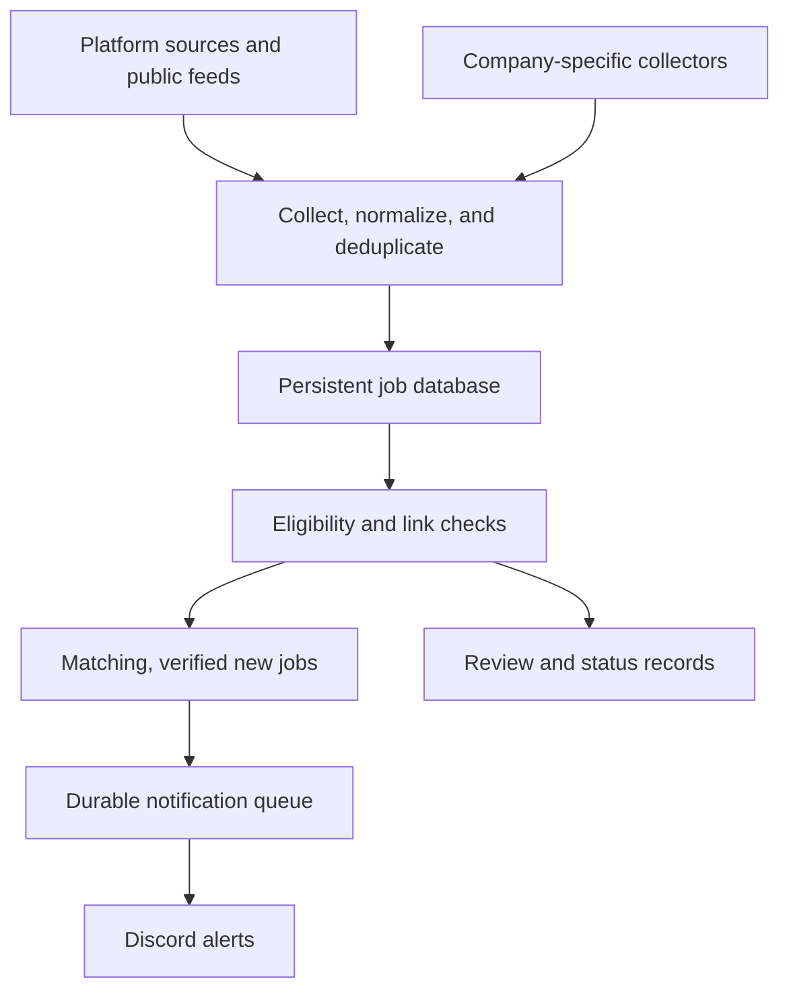

# Internship Watch

Internship scraper system that runs continuously on Azure, checks for new listings every five minutes, and sends matching jobs to Discord.

This scraper brings listings from multiple sources into one database, filters them against requirements, checks for duplicates and usable application links, and sends alerts so I do not have to keep refreshing career pages.

The current setup is tailored to my search and shared with members of my club.

## At a glance

| Area | Current setup |
| --- | --- |
| Hosting | Runs 24/7 on Azure |
| Job collection | Target interval of five minutes |
| Maintenance checks | Every 15 minutes, with operational alerts |
| Notifications | Discord |
| Storage | Persistent SQLite database |
| Geography | United States, including remote roles that allow work from the US |
| Education | Bachelor's-level / undergraduate opportunities |
| Opportunity type | Internships, with qualifying co-ops and undergraduate research programs |
| Role families | SWE, Data, ML, AI, Cloud, Quant, and Product Management |
| Exclusions | Hardware-focused roles and opportunities outside the configured eligibility requirements |

**Five-minute polling is a collection schedule, not a guarantee that every job reaches Discord within five minutes of being posted.** A source must first make the job available, and collection, filtering, validation, and delivery each take time.

## What it looks for

The filters are configured for a current undergraduate junior who is authorized to work in the United States without sponsorship. They are personal search preferences rather than universal eligibility rules.

| Role family | Examples within scope |
| --- | --- |
| Software Engineering | Backend, frontend, full-stack, and other software development internships |
| Data | Data engineering, data science, analytics, and related software-oriented roles |
| Machine Learning and AI | ML engineering, AI engineering, applied AI, and relevant undergraduate research |
| Cloud and Infrastructure | Cloud software, platform engineering, and software-focused infrastructure |
| Quantitative Finance | Quant trading, quantitative development, quantitative research, algorithm development, and related roles |
| Product Management | Product management and closely related product internships |

The search covers all internship seasons and US locations. Relevant co-ops and research programs can qualify when they are compatible with the undergraduate profile; this is not a general feed of full-time or graduate-only jobs.

Filtering considers the role's responsibilities and eligibility information, not just whether its title contains a keyword.

### Included and excluded

- **Included:** internships and qualifying related programs open to bachelor's students, including US-eligible remote opportunities.
- **Excluded:** permanent full-time and new-graduate positions, hardware-focused work, master's- or PhD-only opportunities, and freshman- or sophomore-only programs.
- **Reviewed when unclear:** missing degree requirements, ambiguous graduation windows, uncertain location eligibility, and explicit citizenship or security-clearance restrictions.

An internship can have full-time working hours and still be eligible. A posting that accepts both bachelor's and graduate students is not excluded just because it mentions a master's degree or PhD.

US work authorization does not establish citizenship or security-clearance eligibility. Unclear requirements remain review items rather than being treated as confirmed matches.

## Where jobs come from

The system combines recruiting-platform integrations, public feeds, job-board sources, and company-specific collectors.

| Source | Role in discovery |
| --- | --- |
| Simplify | Collects from the public internship feed; this represents a subset of Simplify's broader coverage |
| Greenhouse | Collects listings from supported company job boards through structured ATS integrations |
| Ashby | Collects listings from supported company job boards through structured ATS integrations |
| Lever | Collects listings from supported company job boards through structured ATS integrations |
| LinkedIn (employer board) | Collects LinkedIn’s own openings through SmartRecruiters |
| Company-specific career pages | Dedicated collection logic for companies that need handling beyond the shared integrations |

### Company-specific coverage

The [last verified Azure release](docs/CURRENT_DEPLOYMENT.md) (`31d418e`) has **213 enabled sources** and **212 company watchlist entries**. These are configuration counts, not counts of open internships or guarantees of complete direct coverage. Several employers rely on public-feed discovery; see the [finance and quant coverage audit](docs/FINANCE_EXPANSION.md) for known gaps. Simplify discovery uses the public Summer 2027 repository feed, which can lag employer postings.

### Separate Handshake and LinkedIn alerts

Handshake and LinkedIn marketplace discovery use [native daily account alerts](docs/ADDITIONAL_DISCOVERY_CHANNELS.md). They do not feed the Azure scraper, SQLite database, or Discord queue, and are separate from five-minute polling. LinkedIn’s own employer board is a distinct source.

## How the pipeline works

### 1. Collect and normalize

Scheduled collectors fetch available listings and convert their different formats into common job records. Records retain source provenance so the same opportunity can be traced back to where it was discovered.

Stored information includes available company, title, location, description, posting and application URLs, source identifiers, discovery timestamps, and subsequent check results.

### 2. Identify duplicates and updates

Listings are compared using source identifiers, requisition information, and normalized URLs. When evidence points to the same job, the system updates the existing record instead of treating each appearance as a new opportunity.

Matching is conservative: two jobs with similar titles are not automatically the same requisition.

Persistent storage preserves discovery and notification state across process restarts. A restart should not turn all previously collected jobs into new alerts.

### 3. Apply eligibility filters

The classifier evaluates geography, opportunity type, education requirements, role family, and hardware-related responsibilities.

A record can be included, excluded, or held for review. Missing eligibility details remain visible rather than being silently interpreted as proof that the applicant qualifies.

### 4. Validate posting and application links

Job descriptions and application destinations are checked separately. A page loading successfully does not necessarily mean it still describes the correct job or accepts applications for that opening.

Validation considers issues such as:

- Broken URLs and explicit closure messages.
- Redirects to a generic careers homepage.
- Missing descriptions or mismatched job identities.
- Login requirements, access restrictions, and JavaScript-dependent application flows.
- Stale cohorts or seasons that require additional confirmation.

An inaccessible or inconclusive page is recorded as **unverified**, rather than automatically being called closed. Records that need review remain available in the database and reports.

### 5. Queue and deliver alerts

Matching, verified new jobs enter a persistent notification queue for Discord delivery. Failed deliveries can be retried without losing the job or incorrectly treating an unsuccessful send as completed.

The implementation supports Discord incoming webhooks, which allow automated channel messages without requiring an interactive bot. Discord is the notification destination; the collection worker runs separately on Azure.

New qualifying listings that still need verification go into a separate digest with duplicate suppression. A verified posting can trigger an alert when application access remains unverified, with that status labeled; a known closed application blocks the immediate alert.

Initial collection can be silent to avoid flooding the channel with existing listings. The implementation also supports an initial digest option.

## Storage and reliability

The backend is written in Python and uses SQLite with write-ahead logging and transactions. The database stores canonical jobs, source evidence, history, validation results, and notification state.

Reliability features include:

- A separate, durable notification outbox.
- Request timeouts, bounded retries, and pagination safeguards.
- Source-level failure handling so problems can be identified and reported.
- Process locking to prevent overlapping worker runs.
- Incident suppression to reduce repeated operational messages.
- Backup and restore support for persistent state.

Completed alerts are deduplicated, but delivery is not an absolute exactly-once guarantee. For example, if Discord accepts a message and the worker crashes before saving the receipt, retrying may produce a duplicate.

## Monitoring and maintenance

The current Azure setup runs maintenance checks every **15 minutes** and sends operational alerts when those checks detect problems.

Job discovery alerts and operational alerts serve different purposes: one reports opportunities; the other reports failures that may affect coverage or delivery. The implementation supports separate operational routing.

### Independent heartbeat monitoring

The Azure deployment uses **Healthchecks.io** to monitor the worker and maintenance supervisor independently and send email alerts.

A heartbeat is a small periodic check-in from the worker to an independent service. If expected check-ins stop arriving within the configured interval and grace period, that service can alert the operator.

This is useful because a worker that has stopped completely cannot send its own failure notification. External monitoring can detect missing check-ins even when the Azure process or host is unavailable.

## Browsing collected jobs

Discord provides timely alerts, while saved reports support reviewing the broader collection.

Available outputs include:

- A searchable HTML job report.
- CSV exports.
- JSON job records.
- Per-job link-validation evidence.
- Source-health information.

Exports are snapshots from their generation time. The persistent database holds the underlying records and history.

## Freshness and coverage limits

The goal is fast, useful discovery with clear evidence, not guaranteed coverage of every internship.

- A five-minute poll only discovers jobs already exposed by a source. Community curation and upstream exports can introduce additional delay.
- Rate limits, outages, slower collection cycles, and validation backlogs can delay alerts.
- A job can appear through several sources, while another may be available only on a company-specific page.
- A working application form does not always prove that a particular cohort is still recruiting.
- Strict validation can hold back legitimate listings when the available evidence is incomplete.
- Maintenance checks identify observable failures; no single check proves that every source is complete or every classification is correct.

The system discovers and reports opportunities. It does not submit applications.

## Deployment and configuration

The current deployment runs continuously on Azure. Its important operating settings include:

| Setting | Purpose |
| --- | --- |
| Source registry | Determines which boards, feeds, and company collectors are enabled |
| Eligibility filters | Controls geography, education, opportunity type, and role scope |
| Collection interval | Targets a new collection cycle every five minutes |
| Maintenance interval | Schedules operational checks every 15 minutes |
| Persistent database storage | Preserves jobs, history, and delivery state |
| Discord configuration | Routes job notifications and operational messages |
| Heartbeat configuration | Healthchecks.io monitors missed check-ins independently |
| Backups | Daily local backups are scheduled; automatic off-host backups await the storage connection |

Webhook URLs, heartbeat URLs, and any source credentials belong in private deployment configuration, not in the repository. Azure instance details and source-specific setup instructions should be documented alongside the actual deployment configuration.
